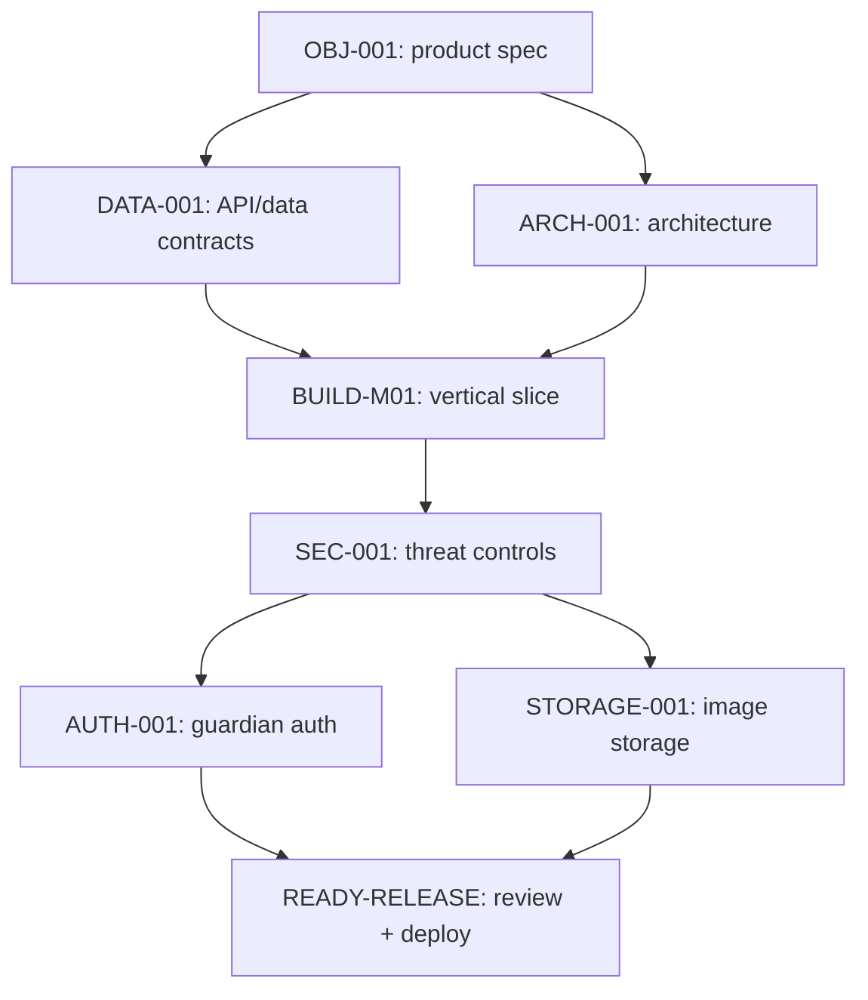

# Roadmap e orquestração SDD + Graph + Loop

## Grafo de dependências

## Issue workflow

Cada tarefa recebe objetivo, revisão-base, dependências, arquivos, permissões, saída, critérios de aceite, oráculo, limite de tentativas, riscos e aprovador. Estados: `DRAFT → READY → RUNNING → VERIFYING → ACCEPTED`; também `BLOCKED`, `REWORK`, `REJECTED`, `SUPERSEDED`. Vibe coding serve à exploração com dados fictícios; só se incorpora após converter aprendizado em spec/contrato.

## Sequência

| Ordem | Resultado | Gate |
|---|---|---|
| M01 | demo full-stack mock, testes, documentação, CI, Pages/Render manual | merge após checks e revisão |
| SEC-001 | threat model, abuso, moderação, logging, quotas e privacidade infantil | revisão de privacidade |
| AUTH-001 | login e isolamento de dados por responsável | teste de autorização negativa |
| STORAGE-001 | assets duráveis, retenção e exclusão | backup/restore e URLs privadas |
| RELEASE-001 | publicação via GitHub Pages e Render | aprovação explícita, custo e visibilidade |
| AI-LIVE-001 | ativar OpenAI real com teto de custo | secret configurado pelo responsável e smoke check aprovado |

## Graph/Loop check-in

- **Prepare:** confirmar objetivo e SHA; ler dependências.
- **Plan:** limitar alteração, riscos, critério e limite de tentativa.
- **Act:** realizar apenas a tarefa autorizada; sem gasto/chamada live por padrão.
- **Observe:** inspecionar diff, workflow, logs e arquivos afetados.
- **Verify:** aplicar oráculos automatizados e revisão independente.
- **Decide:** aceitar, corrigir dentro do limite, bloquear ou escalar.
- Cada issue/PR deve registrar base SHA, critérios, resultados reais e pendências; não inferir aceite de deploy apenas por YAML.
